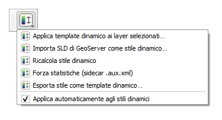
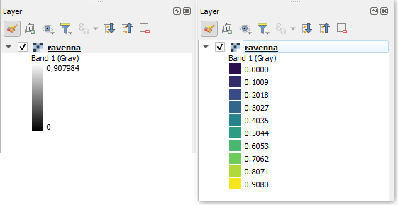

# Guida a Raster Auto Style

Questa guida spiega come usare il plugin passo per passo. Per una panoramica breve vedi il [README](../README.md).

## Indice

1. [A cosa serve](#1-a-cosa-serve)
2. [Installazione](#2-installazione)
3. [Primo utilizzo](#3-primo-utilizzo)
4. [Le voci del menu](#4-le-voci-del-menu)
5. [Min/Max o percentili](#5-minmax-o-percentili)
6. [Da dove arrivano le statistiche](#6-da-dove-arrivano-le-statistiche)
7. [Applicazione automatica](#7-applicazione-automatica)
8. [Creare un template dinamico](#8-creare-un-template-dinamico)
9. [Problemi comuni](#9-problemi-comuni)

## 1. A cosa serve

Se hai tanti raster della stessa grandezza fisica (temperatura, quota, indice) ma con valori diversi, uno stile *Singola banda falso colore* con valori assoluti va bene solo per uno di essi. Con questo plugin scrivi lo stile **una volta sola** con stop relativi (0 = minimo, 1 = massimo) e il plugin lo riscala sul minimo e massimo di ogni raster.

Funziona solo con il renderer *Singola banda falso colore*.

## 2. Installazione

1. Scarica `raster_auto_style-vX.Y.Z.zip` dalla pagina [Releases](https://github.com/pigreco/raster_auto_style/releases).
2. In QGIS: **Plugin → Gestisci e installa plugin → Installa da ZIP** e scegli il file.
3. Le azioni compaiono nel pulsante con l'icona del plugin in barra strumenti e in **Raster → Raster Auto Style**.

Se il pulsante non si vede: **Visualizza → Barre degli strumenti → Raster Auto Style**.

## 3. Primo utilizzo

1. Carica un raster in QGIS.
2. Seleziona il layer nel pannello Layer.
3. Scegli **Applica template dinamico ai layer selezionati…** e indica una QML dinamica (puoi iniziare da [template_esempio.qml](../template_esempio.qml), una rampa viridis a 10 classi).
4. Lo stile viene riscalato sul range del raster. Apri Proprietà → Simbologia per vedere i valori assoluti.

Puoi selezionare più layer e applicare il template a tutti insieme.

## 4. Le voci del menu

Il menu (pulsante in barra strumenti o **Raster → Raster Auto Style**) ha sette voci. Le prime cinque agiscono sui layer, poi ci sono un interruttore e il collegamento a questa guida.

| Voce | Su quali layer agisce | Cosa fa |
|---|---|---|
| Applica template dinamico ai layer selezionati… | tutti i raster selezionati | Carica una QML dinamica e la riscala |
| Importa SLD di GeoServer come stile dinamico… | tutti i raster selezionati | Crea lo stile dalla ColorMap di un SLD |
| Ricalcola stile dinamico | tutti i raster selezionati | Rilegge le statistiche e riscala di nuovo |
| Forza statistiche (sidecar .aux.xml) | tutti i raster selezionati | Calcola le statistiche esatte e le salva |
| Esporta stile come template dinamico… | solo il layer attivo | Salva lo stile del layer come QML dinamica |
| Applica automaticamente agli stili dinamici | tutto il progetto | Attiva o disattiva il riscalamento automatico |
| Guida… | nessuno | Apre questa guida nel browser |

Le voci che lavorano sui «layer selezionati» usano la selezione del pannello Layer e ignorano i layer che non sono raster. Se non c'è nessun raster selezionato compare un avviso. L'esportazione usa invece il layer **attivo**.

### Applica template dinamico ai layer selezionati…

1. Seleziona uno o più raster nel pannello Layer.
2. Scegli la voce e indica un file `.qml`.
3. Il plugin carica la QML su ogni layer e riscala gli stop sul range del raster.

Con un solo layer compare un messaggio con il range applicato e la fonte delle statistiche (per esempio «0 – 0,908 (metadati del file)»). Con più layer compare solo il riepilogo «Template applicato a N layer su M».

Se la QML non è dinamica (manca `dynamic_minmax=true`) il plugin si ferma con un avviso e non prosegue sugli altri layer.

### Importa SLD di GeoServer come stile dinamico…

1. Seleziona uno o più raster.
2. Scegli il file `.sld` (o `.xml`).
3. Indica il numero di classi della rampa, da 0 a 255. Il valore predefinito è 10. Con `0` si mantengono le classi dell'SLD.
4. Il plugin legge la ColorMap, crea lo stile falso colore e lo rende dinamico.

Per ogni layer compare «SLD importato, N classi». Una volta importato, lo stile si può esportare come template con l'ultima voce di questo elenco.

### Ricalcola stile dinamico

Rilegge le statistiche del raster e riapplica lo stile. Serve quando il file è cambiato oppure dopo aver calcolato le statistiche esatte. Sui layer il cui stile non è dinamico mostra l'avviso «lo stile non è dinamico».

### Forza statistiche (sidecar .aux.xml)

Calcola le statistiche **esatte** leggendo tutto il raster e le scrive nel file `.aux.xml` accanto, senza modificare il TIFF. Il calcolo gira in background, quindi QGIS resta utilizzabile anche su raster grandi. Al termine compare «Statistiche salvate in …» e, se il layer ha uno stile dinamico, viene riscalato in automatico.

Non funziona su file remoti (`/vsicurl`) né in cartelle in sola lettura.

### Esporta stile come template dinamico…

1. Rendi attivo il layer con lo stile che vuoi esportare (clic sul layer).
2. Scegli come calcolare il range dei raster futuri: **Min/Max del file** oppure **Percentili (configurabili)**.
3. Con i percentili indica il limite inferiore e quello superiore (predefiniti 2 e 98 %).
4. Scegli dove salvare la QML. Il nome proposto è `<layer>_dinamico.qml`.

La QML ha gli stop relativi tra 0 e 1 e l'indicazione della modalità. Il layer originale non cambia. Compare «Template salvato (N classi)».

### Applica automaticamente agli stili dinamici

È una voce con la spunta, **attiva per default**. Il riscalamento automatico è descritto nel [punto 7](#7-applicazione-automatica). Disattivandola, lo stile si riscala solo con le altre voci del menu. L'impostazione viene ricordata tra una sessione e l'altra.

### Guida…

Apre questa pagina nel browser predefinito. Serve una connessione a internet.

## 5. Min/Max o percentili

Ogni template ha una modalità, scelta quando lo si esporta:

| Modalità | Cosa usa | Quando |
|---|---|---|
| Min/Max | minimo e massimo del raster | dati senza valori anomali |
| Percentili | taglio cumulativo, per default 2–98% | dati con pochi valori estremi che appiattiscono la rampa |

I percentili sono configurabili. In modalità percentili il range è sempre una **stima** calcolata sul raster.

## 6. Da dove arrivano le statistiche

Per il Min/Max il plugin cerca, nell'ordine:

1. i tag `STATISTICS_MINIMUM/MAXIMUM` dentro il file (sono gli stessi letti da GeoServer);
2. il file accanto `<raster>.tif.aux.xml`;
3. una stima su un campione di 250.000 pixel.

I tag nel file hanno la precedenza sul sidecar perché QGIS stesso scrive i `.aux.xml`.

Quando i valori sono stimati compare un avviso nella barra messaggi. Per ottenere valori esatti usa **Forza statistiche**: calcola le statistiche complete e le salva nel `.aux.xml`, **senza modificare il TIFF**. Il calcolo gira in background. Non funziona su file remoti (`/vsicurl`) né in cartelle in sola lettura. Dopo averlo fatto, usa **Ricalcola stile dinamico** per rileggere i valori.

## 7. Applicazione automatica

L'ultima voce del menu, **Applica automaticamente agli stili dinamici**, attiva o disattiva il riscalamento automatico. Quando è attiva, lo stile si riscala da solo:

- quando carichi una QML dinamica da Proprietà → Stile;
- quando apri un TIFF che ha accanto una QML dinamica con lo stesso nome;
- quando apri un progetto con layer dinamici (in questo caso i layer non toccati restano come sono, così il progetto non risulta modificato).

L'impostazione viene ricordata tra una sessione e l'altra.

## 8. Creare un template dinamico

Un template è una normale QML con la custom property `dynamic_minmax=true` e item relativi tra 0 e 1. Tre modi per ottenerlo.

### Da uno stile che hai già in QGIS

1. Imposta lo stile a tuo piacimento su un layer.
2. Con il layer attivo scegli **Esporta stile come template dinamico…**.
3. Scegli modalità (Min/Max o percentili, con i valori dei percentili) e dove salvare.

Lo stile originale del layer non cambia.

### Da un SLD di GeoServer

QGIS da solo non importa gli SLD dei raster. Con **Importa SLD di GeoServer come stile dinamico…** il plugin legge la ColorMap e la applica al layer. Ti chiede il numero di classi: per esempio puoi ridurre da 50 a 10, oppure `0` per tenere quelle dell'SLD.

### A mano

Parti da [template_esempio.qml](../template_esempio.qml) e cambia colori e posizioni degli item.

### Legenda

Per default QGIS mostra una barra continua. I template del plugin usano invece la **legenda a classi** (un riquadro di colore per ogni valore). Per cambiarla: Proprietà → Simbologia → Impostazioni legenda → «Usa legenda continua».

<!-- screenshot: docs/img/legenda.png — confronto barra continua e legenda a classi -->

## 9. Problemi comuni

| Sintomo | Causa e rimedio |
|---|---|
| Messaggio «valori stimati» | Il file non ha statistiche. Usa **Forza statistiche**, poi **Ricalcola**. |
| Stile non si riscala | Il layer non è *Singola banda falso colore* oppure la QML non contiene `dynamic_minmax=true`. |
| Dopo ricaricare la stessa QML i valori sono sballati | Ricarica la QML da Proprietà → Stile con l'automatismo attivo: lo stato interno viene azzerato. |
| Forza statistiche non funziona | File remoto o cartella in sola lettura. Copia il file in locale. |
| Il pulsante non compare | Visualizza → Barre degli strumenti → Raster Auto Style. |

Il plugin è sperimentale. Segnala problemi su [GitHub Issues](https://github.com/pigreco/raster_auto_style/issues).
